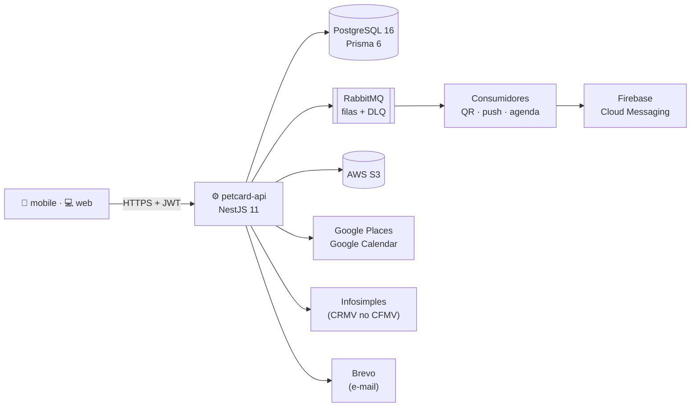

<div align="center">


# PetCard API

**API REST do PetCard: guarda a saúde dos pets, gera as carteiras digitais e conecta o app do tutor à área do veterinário.**

[](https://github.com/PetCardOrg/petcard-api/actions/workflows/ci.yml)
[](https://github.com/PetCardOrg/petcard-api/actions/workflows/ci.yml)
[](https://github.com/PetCardOrg/petcard-api/actions/workflows/cd-production.yml)
[](LICENSE)

[](https://nestjs.com)
[](https://www.prisma.io)
[](https://www.postgresql.org)
[](https://www.rabbitmq.com)
[](https://petcard-api-v1yi.onrender.com)

[Funcionalidades](#funcionalidades) · [Arquitetura](#arquitetura) · [Como rodar](#como-rodar) · [Testes](#testes) · [Deploy](#deploy) · [Ecossistema](#ecossistema)

</div>

---

## Funcionalidades

A API atende dois públicos com o mesmo backend: o **tutor**, pelo app mobile, e o **veterinário**, pela área web. Cada um entra com o seu papel (`TUTOR` ou `VET`) no token de acesso.

| Domínio | O que a API faz |
|---|---|
| 🔐 Autenticação | Cadastro, login, verificação de e-mail, recuperação de senha e login com Google |
| 🐶 Pets e prontuário | Pets do tutor com vacinas, vermífugos, medicações e notas clínicas |
| 📎 Comprovantes | Fotos e PDFs anexados aos registros, guardados em bucket privado e lidos por link temporário |
| 🪪 Carteira digital | QR Code e link públicos da carteira, exportação em PDF e QR de coleira para pet perdido |
| 🩺 Veterinário | CRMV conferido no CFMV, vínculo com o pet pelo QR e registros assinados com nome e CRMV |
| 🧾 Histórico | Trilha imutável de quem registrou, alterou ou excluiu cada item |
| 📍 Clínicas | Busca de clínicas próximas pelo Google Places, com filtro de raio e de funcionamento |
| 📅 Agenda | Consultas sincronizadas com o Google Agenda do tutor |
| 🔔 Lembretes | Push de próximas doses e consultas pelo Firebase Cloud Messaging |

São 83 endpoints, documentados no Swagger e no [OpenAPI + Postman do petcard-docs](https://github.com/PetCardOrg/petcard-docs/blob/main/docs/api/README.md).

## Arquitetura



| Camada | Tecnologia |
|---|---|
| Framework | NestJS 11 + Node.js 20 LTS + TypeScript (strict) |
| Banco | PostgreSQL 16 (imagem PostGIS 3.4) + Prisma 6 |
| Mensageria | RabbitMQ 3: filas de QR Code, push e agenda, cada uma com DLX/DLQ e retry de 1 s, 2 s e 4 s |
| Arquivos | AWS S3 (público para fotos, privado com link de 5 min para comprovantes) |
| Autenticação | JWT próprio (HS256 + bcrypt), guards globais com `@Public()` e verificação de ID token do Google |
| Segurança | `helmet`, CORS restrito em produção, rate limit por rota e `trust proxy` ajustado ao Render |
| Contratos | DTOs do [`@petcardorg/shared`](https://github.com/PetCardOrg/petcard-shared) |
| Cache | Redis 7 (provisionado no compose, ainda sem uso no código) |

<details>
<summary><b>Módulos</b> (<code>src/modules</code>)</summary>

| Módulo | Responsabilidade |
|---|---|
| `auth` | Cadastro, login, e-mail, senha e login com Google |
| `tutor` · `veterinario` | Perfis, CRMV e exclusão de conta |
| `pet` | Cadastro e fotos dos pets |
| `health` | Vacinas, vermífugos e medicações |
| `vet-note` | Notas clínicas do veterinário |
| `anexo` · `upload` | Comprovantes e envio de arquivos |
| `historico` | Trilha imutável das ações clínicas |
| `card` · `coleira` | Carteira digital, QR Code, PDF e QR de coleira |
| `clinica` | Busca de clínicas no Google Places |
| `appointment` · `calendar` | Consultas e sincronização com o Google Agenda |
| `notification` · `reminder` | Push e lembretes de doses e consultas |
| `queue` | Topologia do RabbitMQ (filas, DLX e retry) |
| `mail` | Envio de e-mails (Brevo ou SMTP) |

</details>

## Como rodar

**Pré-requisitos:** Node.js 20 LTS, npm 10, Docker e um token do GitHub com escopo `read:packages` (para baixar o `@petcardorg/shared`).

```bash
git clone https://github.com/PetCardOrg/petcard-api.git
cd petcard-api

export NODE_AUTH_TOKEN=<seu_token_read_packages>
npm install

cp .env.example .env            # os defaults já casam com o compose local
docker compose -f docker/docker-compose.yml up -d

npx prisma migrate dev
npm run db:seed                 # opcional: contas de exemplo (senha petcard123)

npm run start:dev               # http://localhost:3000 · Swagger em /docs
```

> O Swagger em `/docs` fica disponível fora de produção. Sem chaves externas no `.env`, a API continua subindo: a consulta de CRMV usa o provedor `stub`, o push fica desligado (`FCM_ENABLED=false`) e os e-mails saem no console.

<details>
<summary><b>Serviços do compose local</b></summary>

| Serviço | Porta | Credenciais |
|---|---|---|
| PostgreSQL + PostGIS | 5432 | `petcard` / `petcard123` |
| Redis | 6379 | |
| RabbitMQ | 5672 (AMQP) · 15672 (painel) | `petcard` / `petcard123` |

</details>

<details>
<summary><b>Scripts</b></summary>

| Comando | O que faz |
|---|---|
| `npm run start:dev` | Sobe em modo watch |
| `npm run build` · `npm run start:prod` | Build e execução de produção |
| `npm run lint` · `npm run lint:check` | ESLint com e sem correção |
| `npm run typecheck` | Checagem de tipos |
| `npm test` · `npm run test:cov` | Testes unitários e de integração, com cobertura |
| `npm run test:e2e` | Testes ponta a ponta (precisa do Postgres) |
| `npm run db:seed` | Popula o banco com dados de exemplo |
| `npm run openapi:json` | Gera o `openapi.json` sem subir a infraestrutura |
| `npm run reminders:run` | Dispara os lembretes manualmente |
| `npm run qr:regenerate` | Regenera os QR Codes das carteiras |

</details>

## Testes

A suíte segue a política de **cobertura de confiança** ([ADR-006](https://github.com/PetCardOrg/petcard-docs/blob/main/architecture/adr/006-cobertura-de-confianca.md)): só se escreve teste quando a falha dele significaria uma regra de negócio quebrada ou um usuário afetado.

| Tipo | Ferramenta | Escopo |
|---|---|---|
| Unitário | Jest | Regras de negócio, com Prisma e serviços externos simulados |
| Integração | Jest + Supertest | Contrato das rotas, guards e validação |
| Ponta a ponta | Jest + Postgres real | Fluxos vitais |

O CI (`lint:check`, `typecheck`, `test:cov`, `test:e2e` e `build`) roda em todo push e PR para `main` e `develop`. A catraca de cobertura (83/78/90/85) impede regressão.

## Deploy

| Ambiente | Onde | Como |
|---|---|---|
| Staging | Render + Supabase + CloudAMQP | Automático a cada push na `develop` ([ADR-010](https://github.com/PetCardOrg/petcard-docs/blob/main/architecture/adr/010-infra-de-staging-render-supabase-cloudamqp.md)) |
| Produção | [petcard-api-v1yi.onrender.com](https://petcard-api-v1yi.onrender.com) | Push na `main` → aprovação manual no GitHub → Deploy Hook do Render ([ADR-011](https://github.com/PetCardOrg/petcard-docs/blob/main/architecture/adr/011-cd-de-producao-github-environments-e-dlx-por-ambiente.md)) |

A imagem Docker roda `prisma migrate deploy` ao iniciar. Como o plano gratuito do Render hiberna, os lembretes diários também são disparados pelo workflow [`reminders.yml`](.github/workflows/reminders.yml), às 9h de Fortaleza.

## Ecossistema

| Repositório | O que é |
|---|---|
| **petcard-api** | API REST (você está aqui) |
| [petcard-web](https://github.com/PetCardOrg/petcard-web) | Área do veterinário em React + Vite |
| [petcard-mobile](https://github.com/PetCardOrg/petcard-mobile) | App do tutor em React Native + Expo |
| [petcard-shared](https://github.com/PetCardOrg/petcard-shared) | DTOs e enums compartilhados |
| [petcard-docs](https://github.com/PetCardOrg/petcard-docs) | Documentação central, ADRs e board |

Para contribuir, siga o [guia de contribuição](https://github.com/PetCardOrg/petcard-docs/blob/main/CONTRIBUTING.md). Projeto de TCC em Ciência da Computação, UNIFOR, 2026, por Álvaro Araújo, Camila Martins e Ricardo Temporal. Licença [MIT](LICENSE).
